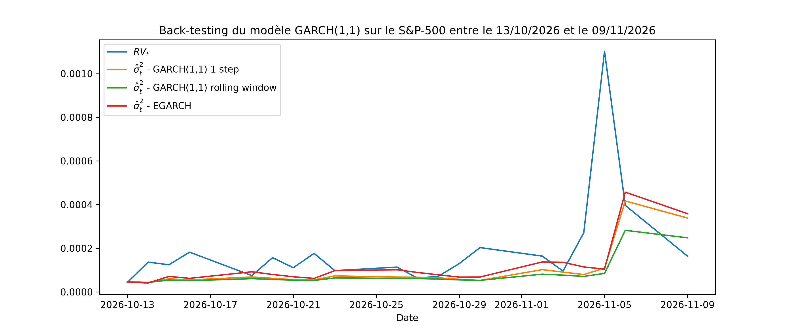

# VolatilityForecasting : Économétrie des Séries Temporelles & Prévision de Volatilité Hors-Échantillon

Ce dépôt contient un projet de finance quantitative en Python axé sur la modélisation, la prévision et l'évaluation de la volatilité du S&P 500 (`^GSPC`) à l'aide de modèles **GARCH(1,1)** et **EGARCH**, et de proxies de **Volatilité Réalisée** haute-fréquence.

## 📌 Présentation du Projet

La prévision précise de la volatilité est essentielle pour la gestion des risques (calcul de la VaR), l'évaluation des options et l'optimisation de portefeuille. Ce projet met en œuvre une démarche économétrique rigoureuse en 4 étapes :

1. **Analyse de Stationnarité** : Test de la stationnarité des log-rendements à l'aide du test Augmenté de Dickey-Fuller (ADF).
2. **Volatilité Réalisée de Référence** : Construction de proxies de volatilité intégrée quotidienne basés sur les rendements intraday à 5 minutes.
3. **Estimation GARCH In-Sample** : Estimation des paramètres du GARCH(1,1) par Maximum de Vraisemblance (MLE) et analyse de la persistance des chocs ($\alpha + \beta$).
4. **Évaluation Hors-Échantillon (Out-of-Sample)** : Génération de prévisions glissantes à 1 pas (*1-step-ahead*)
5. **Estimation EGARCH**
6. Comparaison avec la Volatilité Réalisée ($RV_t$) via les métriques RMSE, MAE et QLIKE.

## 📐 Cadre Mathématique et Économétrique

### 1. Log-Rendements & Stationnarité

Les log-rendements quotidiens $r_t$ sont calculés à partir des prix de clôture $P_t$ :

$$
r_t = \ln\left(\frac{P_t}{P_{t-1}}\right)
$$

La stationnarité est vérifiée via le test d'Augmented Dickey-Fuller (ADF) :

$$
\Delta r_t = \alpha + \gamma r_{t-1} + \sum_{i=1}^{p} \beta_i \Delta r_{t-i} + \epsilon_t
$$

* **Hypothèse Nulle (**$H_0$**)** : $\gamma = 0$ (Présence d'une racine unitaire / série non-stationnaire).
* Le rejet de $H_0$ confirme que la série des rendements est stationnaire $I(0)$.

### 2. Volatilité Réalisée ($\text{RV}_t$)

Pour obtenir un proxy empirique de la "vraie" volatilité quotidienne (non observée directement), les log-rendements intraday à 5 minutes $r_{t,j}$ sont agrégés :

$$
\text{RV}_t = \sum_{j=1}^{M} r_{t,j}^2
$$

L'écart-type de la volatilité réalisée quotidienne est défini par $\sqrt{\text{RV}_t}$.

La volatilité annualisée sur $N = 252$ jours de bourse s'exprime par :

$$
\sigma_{\text{annuelle}} = \sqrt{\overline{\text{RV}} \times 252}
$$

### 3. Modèle GARCH(1,1)

L'équation de la variance conditionnelle est donnée par :

$$
\sigma_t^2 = \omega + \alpha r_{t-1}^2 + \beta \sigma_{t-1}^2
$$

Où :

* $\omega > 0$ : Constante de variance à long terme.
* $\alpha \ge 0$ : Coefficient ARCH mesurant la réactivité aux chocs récents ($r_{t-1}^2$).
* $\beta \ge 0$ : Coefficient GARCH mesurant la persistance de la variance ($\sigma_{t-1}^2$).

**Stationnarité & Variance de Long Terme :**

* **Condition de stationnarité** : $\alpha + \beta < 1$.
* **Variance Inconditionnelle de Long Terme** : $\sigma_L^2 = \frac{\omega}{1 - (\alpha + \beta)}$.
* **Cas IGARCH** : Lorsque $\alpha + \beta = 1$, $\sigma_L^2 \to \infty$, signifiant une mémoire infinie des chocs (les effets de variance ne s'estompent pas).

### 3. Modèle EGARCH

L'équation de la variance conditionnelle est donnée par :

$$
\ln\left(\sigma_t^2\right)=\omega+\beta\ln\left(\sigma_{t-1}^2\right)+\alpha \left(\left|z_{t-1}\right|-\mathbb{E}\left[\left|z_{t-1}\right|\right]\right)+\gamma z_{t-1}
$$

Où :

* $z_{t}=\dfrac{\varepsilon_t}{\sigma_t}$, avec $\varepsilon_t=r_t - \mu$ l'innovation
* $\alpha$ : coefficient de *magnitude effect*
* $\gamma$ : coefficient de *leverage effect* (en général $\gamma < 0$)
* $\beta$ : coefficient de persistance du modèle

## 🚀 Détails d'implémentation

### Étape 1 : Téléchargement des Données & Test ADF

Les données quotidiennes du S&P 500 (`2018-01-01` à `2023-12-31`) sont récupérées via `yfinance`.

* **Statistique ADF** : $-11{,}8534$ ($p\text{-value} \approx 7{,}12 \times 10^{-22}$).
* **Conclusion** : Rejet de $H_0$ ; la série est stationnaire et prête pour la modélisation économétrique.

### Étape 2 : Volatilité Réalisée Haute-Fréquence

* Le pas de 5 minutes permet d'éviter les bruits de microstructure de marché (*bid-ask bounce*).
* La variation quadratique agrégée fournit le benchmark $\sqrt{\text{RV}_t}$.

### Étape 3 : Ajustement du Modèle & Facteur d'Échelle (Rescaling)

Lors de l'estimation avec `arch_model`, la mise à l'échelle ($y = r_t \times s$) assure la stabilité de l'optimiseur par Maximum de Vraisemblance.

* **Paramètres Estimés** :
  * $\omega = 0{,}0488$
  * $\alpha = 0{,}1990$
  * $\beta = 0{,}7769$
* **Persistance** : $\alpha + \beta = 0{,}9759$ (forte persistance de la volatilité, typique des indices actions).

### Étape 4 : Prévision Glissante 1-Step-Ahead

Sur l'échantillon de test hors-échantillon, la variance conditionnelle est calculée récursivement :

$$
\hat{\sigma}_{t,\text{scaled}}^2 = \omega + \alpha r_{t-1,\text{scaled}}^2 + \beta \sigma_{t-1,\text{scaled}}^2
$$

$$
\hat{\sigma}_t = \frac{\sqrt{\hat{\sigma}_{t,\text{scaled}}^2}}{s}
$$

## 📊 Résultats Empiriques & Métriques

### Comparaison des modèles avec le proxy hors échantillon



### Performance Hors-Échantillon (Out-of-Sample)

| Méthode | Métrique | Formule | Valeur | Interprétation |
| :--- | :--- | :--- | :--- | :--- |
| **GARCH 1-step** | **RMSE** | $\sqrt{\frac{1}{N} \sum (\sqrt{\text{RV}_t} - \hat{\sigma}_t)^2}$ | **2,39e-04** | Erreur quadratique moyenne |
| **GARCH 1-step** | **MAE** | $\frac{1}{N} \sum \left\| \sqrt{\text{RV}_t} - \hat{\sigma}_t \right\|$ | **1,16e-04** | Erreur absolue moyenne |
| **GARCH 1-step** | **QLIKE** | $\frac{\text{RV}_t}{\hat{\sigma}_t^2} - \ln\frac{\text{RV}_t}{\hat{\sigma}_t^2} - 1$ | **-7,11** | — |
| **Rolling Window** | **RMSE** | — | **2,44e-04** | Erreur quadratique moyenne |
| **Rolling Window** | **MAE** | — | **1,22e-04** | Erreur absolue moyenne |
| **Rolling Window** | **QLIKE** | — | **-6,92** | — |
| **EGARCH** | **RMSE** | — | **2,38e-04** | Erreur quadratique moyenne |
| **EGARCH** | **MAE** | — | **1,12e-04** | Erreur absolue moyenne |
| **EGARCH** | **QLIKE** | — | **-7,22** | — |

### Enseignements Clés

1. **Réactivité aux Chocs** : Le terme ARCH ($\alpha$) permet au modèle d'ajuster immédiatement la volatilité prédite lors des journées de fort stress sur le marché.
2. **Persistance** : Le coefficient GARCH ($\beta \approx 0{,}78$) traduit le phénomène de clustering de volatilité (*volatility clustering*).
3. **Précision** : Une MAE de $1{,}12 \times 10^{-4}$ (EGARCH) valide l'efficacité de la prévision *1-step-ahead* par rapport à la volatilité réalisée à 5 minutes.

## 📦 Installation & Utilisation

```bash
git clone https://github.com/votre-utilisateur/VolatilityGarch.git
cd VolatilityGarch
pip install -r requirements/base.txt
```

**Principales bibliothèques utilisées :**

* `yfinance`
* `pandas`, `numpy`
* `statsmodels` (Test ADF)
* `arch` (Modélisation GARCH)
* `matplotlib`
